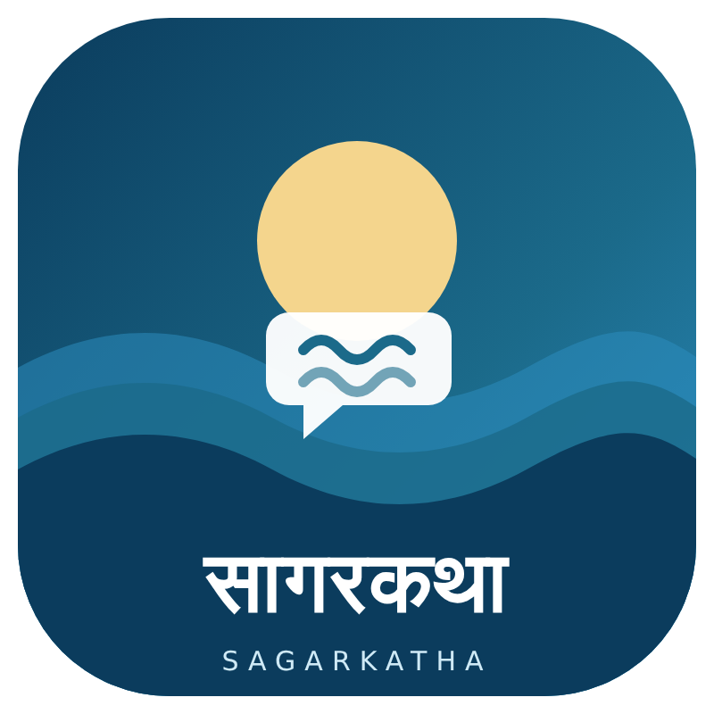
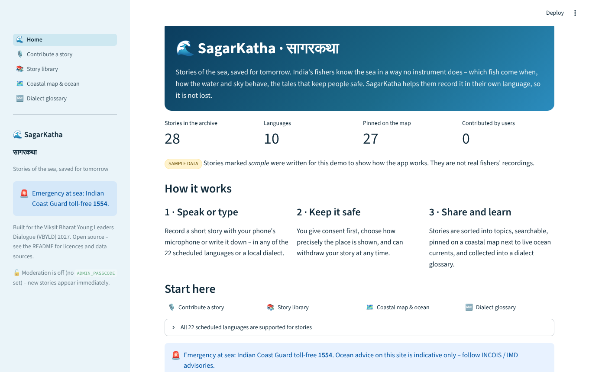
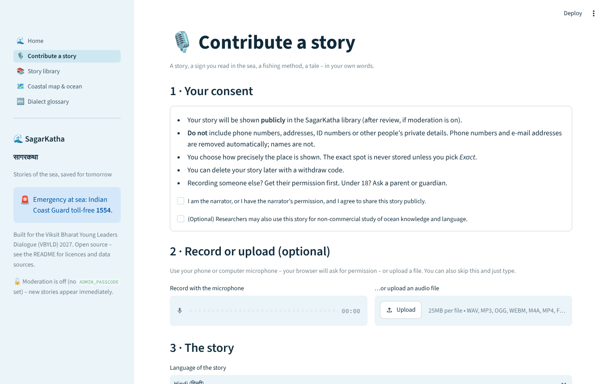
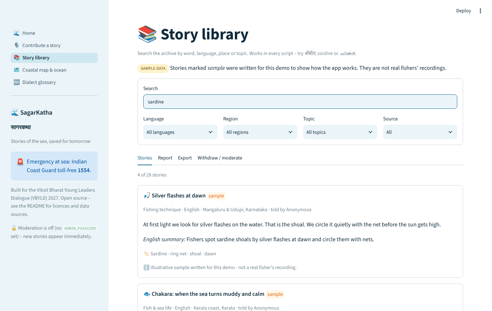
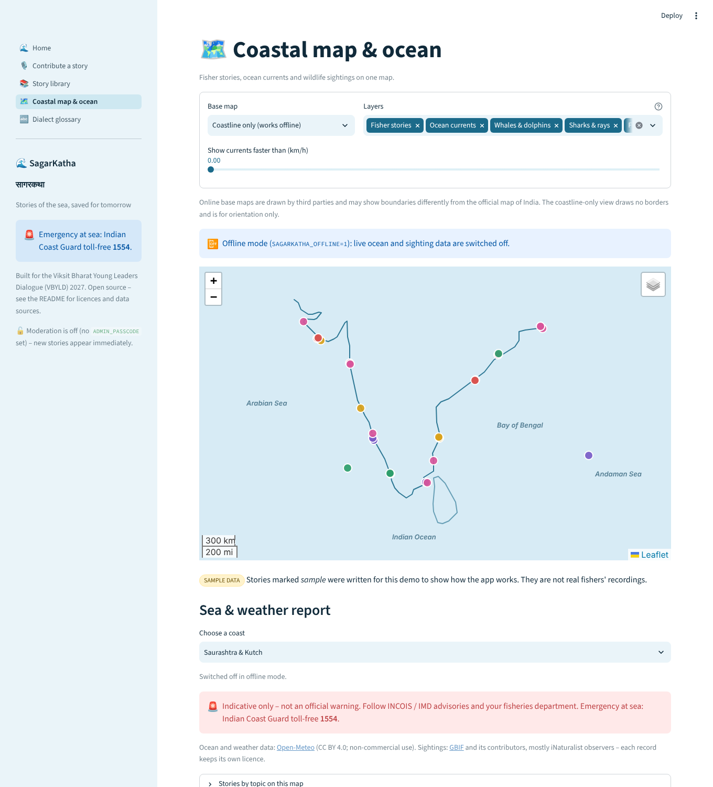

<p align="center">
  
</p>

<h1 align="center">SagarKatha · सागरकथा</h1>
<p align="center"><b>Stories of the sea, saved for tomorrow.</b><br>
A multilingual web app where India's fishers record what they know about the sea – and where anyone can search it, hear it, and see it on a map next to live ocean data.</p>

<p align="center">
  
  
  
</p>

Built for the **Viksit Bharat Young Leaders Dialogue (VBYLD) 2027**.

> **Status: working prototype.** The code is tested (100+ automated tests) and every page runs, but it has **not** been tested with real fishing communities, and the live-data features (Open-Meteo, GBIF, speech-to-text) were tested with mocked responses because the build environment had no access to those services. Read [What is not built yet](#what-is-not-built-yet) before presenting it.

| Home | Contribute a story |
|---|---|
|  |  |
| **Story library** | **Coastal map** (screenshot taken offline: live layers need internet) |
|  |  |

## Why

India's fishers hold detailed, first-hand knowledge of the sea – fish arrivals, weather signs, currents, the tales that keep crews safe – almost all of it oral, dialect-specific and held by elders. See [docs/problem_statement.md](docs/problem_statement.md).

## Features

- 🎙️ **Contribute** – consent first, then record with the microphone, upload audio, or just type. Optional automatic transcript (Sarvam AI or OpenAI Whisper) that the contributor can correct.
- 🗂️ **Automatic topic sorting** – fish & sea life, currents & tides, weather, changes over time, technique, folklore. Works offline with a keyword classifier; optional LLM suggestion.
- 📚 **Searchable library** – search in every Indian script, filters, folktale quizzes, charts, CSV / JSON export.
- 🗺️ **Coastal map** – story pins, **live ocean-current arrows** (Open-Meteo), **whale / shark / fish sightings** (GBIF), reference hotspots, and a **sea & weather report** per coast with a traffic-light rating.
- 🔤 **Dialect glossary** – the same sea-word across languages and coasts (68 draft entries, all marked *needs review*).
- 🌐 **22 scheduled languages + English + "other / local dialect"** for stories and glossary.
- 🔒 **Privacy by design** – consent gate, location blurred before saving, phone / e-mail / ID removal, anonymous by default, one-time withdraw code, optional moderation. See [docs/consent_and_privacy.md](docs/consent_and_privacy.md).

## Quick start

```bash
git clone https://github.com/naitiksinghal179-png/SagarKatha.git
cd SagarKatha
python -m venv .venv && source .venv/bin/activate      # Windows: .venv\Scripts\activate
pip install -r requirements.txt
streamlit run app.py
```

Open <http://localhost:8501>. No API keys are needed. Use `SAGARKATHA_OFFLINE=1 streamlit run app.py` to run without internet (live ocean and sighting data are switched off).

> **Microphone:** browsers only allow microphone access on `https://` pages or `localhost`. If the recorder does not appear to work, check the browser's permission prompt and the site's microphone setting – or upload a file instead.

## Configuration

Copy `.env.example` to `.env`. Everything is optional:

| Variable | Unlocks |
|---|---|
| `SARVAM_API_KEY` | *Transcribe* button using Sarvam AI (all 22 scheduled languages + English). The quick REST API suits clips of about 30 seconds. |
| `OPENAI_API_KEY` | *Transcribe* button using Whisper (about 15 of our languages). |
| `ANTHROPIC_API_KEY` | AI topic suggestion (otherwise the keyword classifier is used). |
| `ADMIN_PASSCODE` | Moderation: new stories wait for approval. |
| `SAGARKATHA_OFFLINE=1` | Never call Open-Meteo / GBIF. |
| `SAGARKATHA_DATA_DIR`, `SAGARKATHA_MAX_AUDIO_MB` | Storage location and upload cap. |

## Tests

```bash
pytest
```

103 tests cover validation, privacy helpers, storage, search in several scripts, audio checks, the transcription clients (mocked HTTP), geometry, the Open-Meteo and GBIF parsers (mocked), map rendering and HTML escaping, and a headless run of every page.

## Project structure

```
SagarKatha/
├── README.md  LICENSE  .gitignore  .env.example  requirements.txt
├── app.py                      # home page + navigation
├── pages/
│   ├── 1_Contribute_Story.py
│   ├── 2_Story_Library.py
│   ├── 3_Coastal_Map.py
│   └── 4_Dialect_Glossary.py
├── data/
│   ├── demo_stories.json       # 28 clearly-labelled SAMPLE stories (8 folktales)
│   └── dialect_glossary.csv    # 68 draft words, all "needs_review"
├── src/
│   ├── story_manager.py        # model, languages, consent, redaction, classification, storage
│   ├── audio_handler.py        # safe audio validation and storage
│   ├── transcription.py        # manual / Sarvam / OpenAI Whisper
│   ├── search.py               # Unicode-aware search + glossary
│   └── map_handler.py          # folium map, currents, sightings, sea report
├── docs/                       # problem, solution, architecture, journeys, consent & privacy
├── assets/                     # logo, architecture diagram, screenshots/
├── tests/
├── demo/demo_video_link.md
└── prototype/                  # earlier single-file HTML prototype (reference only)
```

Small additions beyond the base tree: `prototype/` (the earlier single-file HTML version, see its README), `src/__init__.py` and `src/ui.py` (shared Streamlit helpers), `pytest.ini`, `.streamlit/config.toml` (theme, upload size, no usage stats), `.github/workflows/ci.yml` (runs the tests), `tests/conftest.py` and extra test modules, and `data/uploads/.gitkeep`.

## Data sources and licences

| Source | Used for | Licence / terms |
|---|---|---|
| [Open-Meteo](https://open-meteo.com/) Marine & Forecast APIs | Ocean currents, waves, sea temperature, wind | CC BY 4.0; free tier for non-commercial use – attribution required |
| [GBIF](https://www.gbif.org/) occurrence API (largely iNaturalist) | Whale / shark / fish sightings | Each record keeps its own licence (shown in the popup) |
| [Sarvam AI](https://docs.sarvam.ai/), [OpenAI](https://platform.openai.com/docs) | Optional speech-to-text | Their terms; keys are yours |
| CMFRI *Marine Fisheries Census 2016* | Context figures in `docs/` | Public report |

Sightings are **people's reports, not live tracking**. Sea ratings are **indicative only** – follow INCOIS / IMD advisories; emergency at sea: Indian Coast Guard **1554**.

Code: MIT (see `LICENSE`). Sample stories and glossary words in `data/` were written for this project; contributed stories need their own licence terms agreed with contributors.

## What is not built yet

- Image and video uploads (audio only for now) and user accounts.
- The app *interface* in 22 languages (story content and glossary are multilingual; interface text is English).
- Offline-first mobile experience.
- A production database (stories are in a JSON file; Streamlit Community Cloud storage is ephemeral).
- Native-speaker review of the sample translations and glossary.

The upgrade path is in [docs/system_architecture.md](docs/system_architecture.md).

## Deploying

Streamlit Community Cloud: point it at `app.py`. Add keys under *Secrets*. **Stories saved there disappear on restart** – move storage to a database before collecting real stories.

## Contributing

- **Glossary words:** edit `data/dialect_glossary.csv` (see [docs/user_journey.md](docs/user_journey.md#6-adding-glossary-words-community-workflow)) and run `pytest`.
- **Translations / corrections:** open an issue naming the language and the coast.
- Never commit real recordings or `data/user_stories.json`.

## Acknowledgements

Open-Meteo, GBIF and the iNaturalist observers, Sarvam AI, CMFRI, and the coastal communities whose knowledge this project hopes to help keep.
