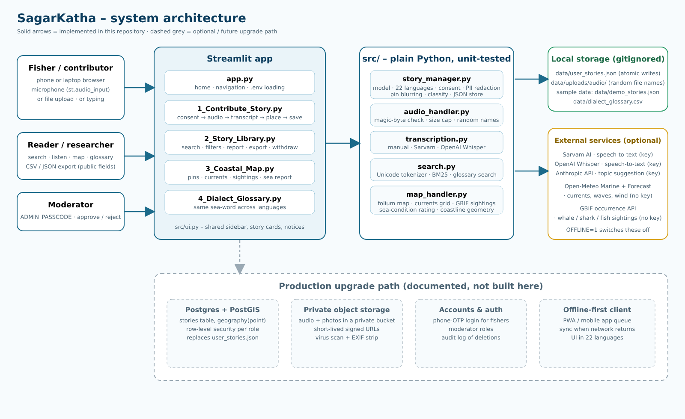

# System architecture

## Layers

| Layer | Files | Notes |
|---|---|---|
| **UI** | `app.py`, `pages/*.py`, `src/ui.py` | Streamlit. `app.py` defines the navigation (`st.navigation`) and the home page. Pages contain layout only. |
| **Domain logic** | `src/story_manager.py`, `src/audio_handler.py`, `src/transcription.py`, `src/search.py`, `src/map_handler.py` | Plain Python, **no Streamlit imports**, fully unit-tested. Could be reused behind an API. |
| **Data** | `data/demo_stories.json`, `data/dialect_glossary.csv` (in git); `data/user_stories.json`, `data/uploads/` (runtime, git-ignored) | Sample data is clearly flagged `source: "sample"`. |
| **External services** | Sarvam AI, OpenAI, Anthropic (all optional, need keys); Open-Meteo, GBIF (no key) | Every call has a timeout and a friendly error. `SAGARKATHA_OFFLINE=1` disables them. |

## Main flows

**Contribute.** Consent checkbox gates the Save button → optional audio is validated by magic bytes and size (`audio_handler.validate_audio`) → optional transcript (`transcription.transcribe`, only on button press) → `StoryManager.create_story` validates, redacts PII, blurs the location, classifies the topic, hashes a fresh withdraw code and writes the JSON file atomically → the page shows the code once.

**Library.** `StoryManager.all_stories()` (approved stories only) → `search.search_stories` (Unicode tokenizer, accent folding, BM25-style ranking with field weights, prefix matching, filters) → cards. All user text is Markdown-escaped before display.

**Map.** `map_handler.build_map` draws a coastline and layers with folium. Live layers come from `fetch_current_grid` (Open-Meteo Marine, ~60 sea points, batched) and `fetch_sightings` (GBIF, 3 taxa × 2 study boxes, last 365 days, widened to 3 years if sparse). Pages cache results (`st.cache_data`, 10–30 min). A partial failure still renders the rest.

## Data model (`Story`)

| Field | Purpose |
|---|---|
| `id`, `title`, `text`, `summary_en` | Content. `summary_en` makes non-English stories findable in English. |
| `language`, `dialect` | One of 22 + `en` + `other`; free-text dialect. |
| `category`, `category_source` | Topic and how it was chosen (`user`, `keyword`, `ai`, `sample`). |
| `region`, `state`, `lat`, `lng`, `precision` | Place, **already blurred** according to `precision`. |
| `species`, `tags` | Searchable labels. |
| `narrator`, `show_name`, `narrator_role` | Name is shown only if `show_name`. |
| `audio_file`, `audio_public`, `transcript_source` | Recording (random server-side name), whether visitors may play it, how the text was produced. |
| `consent_public`, `consent_research`, `consent_at` | Consent record. |
| `status` | `approved` / `pending` / `rejected` (moderation). |
| `withdraw_hash` | SHA-256 of the withdraw code. The code itself is never stored. |
| `source`, `note`, `lesson`, `quiz` | `sample` vs `user`; provenance; curated tale extras. |

## Security controls (implemented)

- **Uploads:** content sniffed from magic bytes, extension mismatch rejected, 25 MB cap (configurable), 10-minute cap for WAV, random file names, no overwrite, `0600` permissions, stored outside any static path.
- **Injection:** user text is Markdown-escaped in the UI; HTML in map popups is escaped; CSV exports neutralise formula injection; image URLs from GBIF must be plain `https`.
- **Privacy:** consent gate, PII redaction, blurred coordinates, anonymous by default, hashed withdraw codes (compared with `hmac.compare_digest`).
- **Abuse:** optional moderation queue (enabled by setting `ADMIN_PASSCODE`), admin attempt limit per session.
- **Secrets:** API keys come from environment variables / `.env` (git-ignored); error messages never include keys.
- **Third parties:** audio leaves the server only when the contributor presses *Transcribe*; text goes to an AI provider only if a key is set *and* the contributor ticks the box.

## Known limitations

- **Single JSON file** – fine for a demo and one server; concurrent writers on several servers would conflict. Streamlit Community Cloud storage is ephemeral, so stories there are lost when the app restarts.
- **Moderation passcode is a shared secret**, not per-user accounts; the attempt limiter is per browser session only.
- **No rate limiting** of submissions beyond the upload cap.
- **No malware scan** of uploaded audio.
- **Coarse geometry:** the coastline has ~70 points. It is for orientation and for filtering inland records, not navigation.
- **Live-data code is tested with mocked responses.** It could not be exercised against the real Open-Meteo / GBIF / Sarvam services from the build environment (network allow-list). Run it once with internet before demoing.

## Production upgrade path

| Prototype | Production |
|---|---|
| `user_stories.json` | Postgres + PostGIS (`geography(point)`), row-level security by role |
| `data/uploads/audio` | Private object storage, signed URLs with short expiry, virus scan |
| Withdraw code | Accounts (phone OTP) *plus* withdraw codes for anonymous contributors; audit log |
| Shared admin passcode | Moderator roles, per-user logins |
| `st.cache_data` | Scheduled job that stores the current-grid snapshot, so the page never calls Open-Meteo per visitor |
| English UI | Localised UI (22 languages) with native-speaker review |
| Browser form | Offline-first PWA / WhatsApp voice-note intake feeding the same domain layer |

## Configuration

See `.env.example`. Nothing is required; every key unlocks one optional feature.
